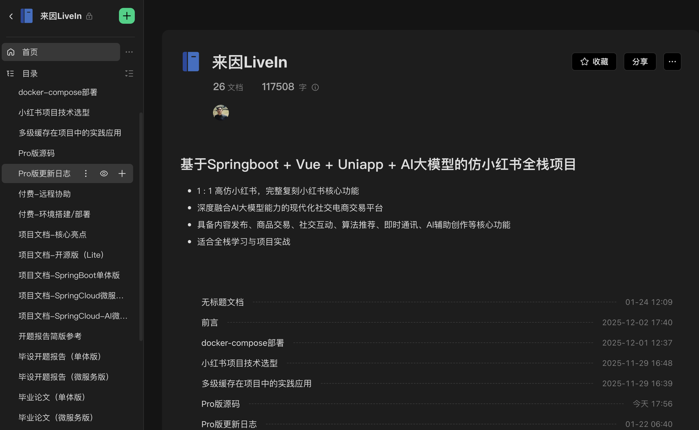

  

<h1 align="center">来因 · LiveIn</h1>

  <b>仿小红书全栈社区系统</b> 笔记 · 博客 · 闲置 · 商城 · 直播 · IM · AI

  Web / 管理后台 / UniApp / Flutter / Electron / 商家端 / 创作中心

  <a href="./README.md">English</a> · <b>简体中文</b>

  
  
  
  
  

  <a href="https://hongshu.website/"><b>▶ 演示站 </b></a>
  &nbsp;·&nbsp;
  <a href="https://www.yuque.com/xiaomage-ippj7/kaoqwn/rqslw69egcbgx7v7?singleDoc#"><b>▶ 获取 Pro 源码 </b></a>
  &nbsp;·&nbsp;
  <a href="https://www.bilibili.com/video/BV1dr7Gz9E53/"><b>▶ 演示视频</b></a>

> **已部署上线的成熟项目、开箱即用，持续迭代升级中**
> 
> **本仓库是开源学习版，克隆即可跑通社区主链路**

---

## 立即体验

> 服务器配置有限，[演示站](https://hongshu.website/) 偶发缓慢请刷新重试。

| 业务端 |                                                   入口                                                    | 说明 |
| :---: |:-------------------------------------------------------------------------------------------------------:| :---: |
| **Web端** |                                   [☞ 点击访问](https://hongshu.website/)                                    | 电脑访问，支持响应式 |
| **运营管理端** |                              [☞ 点击访问](https://hongshu.website/arco-admin/)                              | 电脑访问 |
| **创作中心端** |                            [☞ 点击访问](https://hongshu.website/creator/login/)                             | 电脑访问 |
| **商家端** |                               [☞ 点击访问](https://hongshu.website/merchant/)                               | 电脑访问 |
| **UniApp H5** |         [☞ 点击访问](https://hongshu.website/app/) 或 扫码体验          | 手机体验 |
| **Flutter H5** | [☞ 点击访问](https://hongshu.website/app-flutter/) 或 扫码体验  | 手机体验 |
| **微信小程序** |                                                             | 体验版 |
| **Android** |                 [☞ 点击下载](https://image.mayongjian.cn/packages/laiyin-android-0.1.0.apk)                 | 测试包 |
| **iOS** |                                                   待发布                                                   | 测试包 |
| **Windows** |               [☞ 点击下载](https://image.mayongjian.cn/packages/laiyin-windows-0.1.0-x64.exe)               | 测试包 |
| **Mac** |               [☞ 点击下载](https://image.mayongjian.cn/packages/laiyin-macos-0.1.0-arm64.dmg)               | 测试包 |

---

## 怎么选版本

> 开源版免费学习、跑通笔记社区。需要闲置、商城、AI、微服务或演示站同款，可查看 [Pro版](https://www.yuque.com/xiaomage-ippj7/kaoqwn/rqslw69egcbgx7v7?singleDoc#)。

| 你的需求 | 建议 |
| --- | :---: |
| 学习 SpringBoot + Vue + UniApp，跑通笔记社区 | **开源版（本仓库）** |
| 毕设 / 个人，要推荐算法、闲置交易、支付等完整能力 | **单体版** |
| 团队进阶，要微服务、网关、多实例、IM | **微服务版** |
| 大模型体系 + 独立AI中台， AI创作 / AI审核 / AI客服 | **微服务-AI 版** |
| 商业化落地，系统商城 + 商家端 | **微服务-Shop 版** |
| 演示站同款 | **全端版（推荐）** |

---

## 适合谁

| 学生 / 求职 | 全栈学习 | 创业 / 二开 |
| :---: | --- | :---: |
| 毕设分量够、能讲清架构与推荐算法 有IM / 支付 / AI | SpringBoot、SpringCloud、Vue3、UniApp、Flutter、Electron | 内容社区要变现：闲置、商城、会员选一条主线 |

---

## 本仓库介绍

|  | 实际情况 |
| :---: | --- |
| 后端 | Spring Boot **单体** · JDK 8 · MySQL · Redis · WebSocket + Redis MQ |
| 前端 | Vue3 Web、RuoYi 管理端、UniApp |
| 有 | 发现 / 发布图文 · 赞藏评关 · 专辑标签 · 文本私信 · 本地 / MinIO |

### 仓库地址

| 仓库 | 说明 | Gitee | GitHub |
| :---: | :---: | :---: | --- |
| **HongShu** | 后端（本仓库） | [☞ gitee](https://gitee.com/Maverick_Ma/hongshu) | [☞ github](https://github.com/Ma-YongJian/HongShu) |
| **HongShu-Ui** | 前端 | [☞ gitee](https://gitee.com/Maverick_Ma/hongshu-ui) | [☞ github](https://github.com/Ma-YongJian/HongShu-Ui) |

> 如果这个项目对你有帮助，欢迎 **Star🌟**。

---

## 文档与资料

全套项目文档包括项目简介、核心功能介绍、技术架构、搭建部署、开题报告、毕业论文等，已整理并放至公众号，按需自取即可：

   
  

---

## 支持项目

如果这个项目对你有帮助，欢迎请作者喝杯咖啡☕️，感谢支持项目持续维护。

  

---

## 演示截图（演示站）

<b>App</b> (10 张)

 

<table align="center">
  <tr>
    <td></td>
    <td></td>
    <td></td>
    <td></td>
    <td></td>
  </tr>
  <tr>
    <td></td>
    <td></td>
    <td></td>
    <td></td>
    <td></td>
  </tr>
</table>

<b>Web</b> (9 张)

 

<table align="center">
  <tr>
    <td></td>
    <td></td>
    <td></td>
  </tr>
  <tr>
    <td></td>
    <td></td>
    <td></td>
  </tr>
  <tr>
    <td></td>
    <td></td>
    <td></td>
  </tr>
</table>

<b>管理端</b> (6 张)

 

<table align="center">
  <tr>
    <td></td>
    <td></td>
    <td></td>
  </tr>
  <tr>
    <td></td>
    <td></td>
    <td></td>
  </tr>
</table>

---

## 开源声明

本仓库基于 [MIT](https://opensource.org/licenses/MIT) 开源，**免费学习交流，禁止转售**。谨防假冒仓库与倒卖。  
项目名称「来因 · LiveIn」为开发代号，与「小红书」无商业关联。演示站所用素材来源于网络仅用于功能展示，如涉及侵权请联系作者删除。  
如需商用请自行保证合法合规，运营风险自负。

---

## 致谢

【来因 · LiveIn】参考了多份开源方案，感谢原作者：

- [RuoYi-Vue](https://gitee.com/y_project/RuoYi-Vue) / [RuoYi-Cloud](https://gitee.com/y_project/RuoYi-Cloud)
- [RuoYi-Vue-Plus](https://gitee.com/dromara/RuoYi-Vue-Plus) / [RuoYi-Cloud-Plus](https://gitee.com/dromara/RuoYi-Cloud-Plus)
- [蘑菇博客](https://gitee.com/moxi159753/mogu_blog_v2)
- [仿小红书前端](https://gitee.com/xzjsccz/xiaohongshu) / [yanhuo](https://gitee.com/xzjsccz/yanhuo-springboot-vue)
- [Chat MASTER](https://gitee.com/panday94/chat-master)
- [AJ-Captcha](https://gitee.com/belief-team/captcha)
- [七牛云](https://portal.qiniu.com/signup?utm_source=kaiyuan&utm_media=mogu) 对象存储
- [JetBrains](https://www.jetbrains.com/) 开源 License
- [百度千帆](https://ai.baidu.com/ai-doc/ANTIPORN/ek3h6x90n) 审核能力
